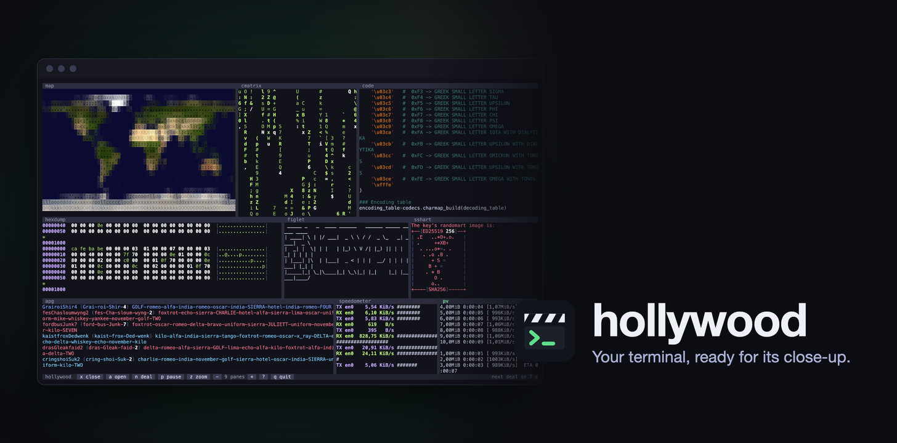
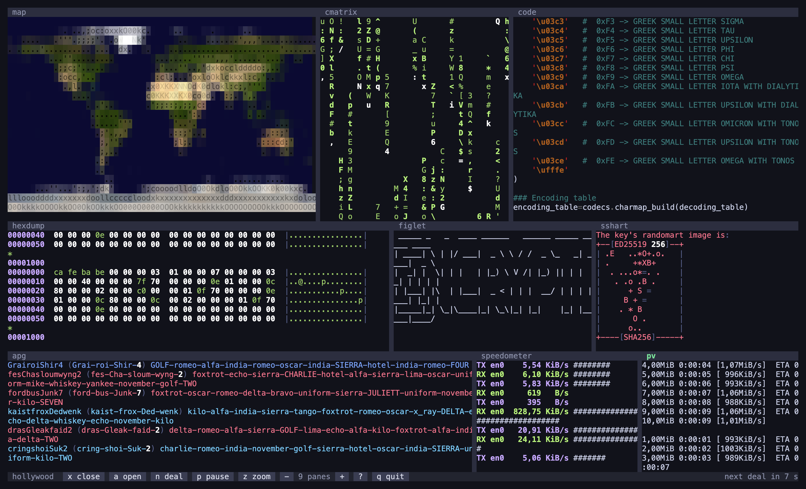
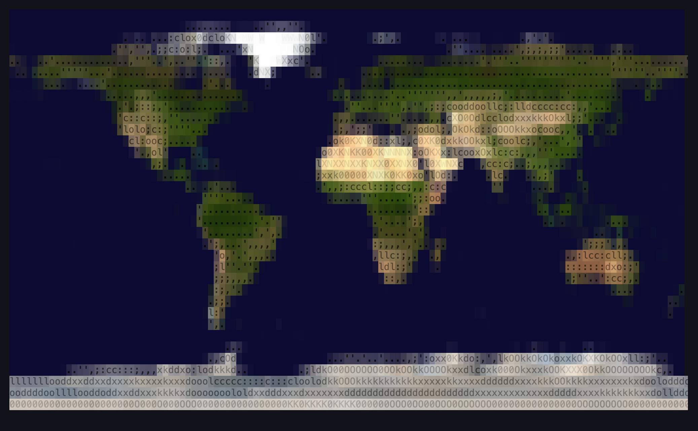
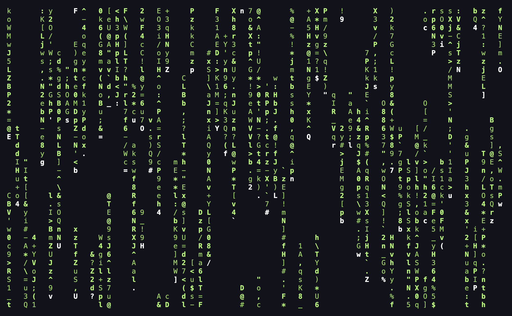
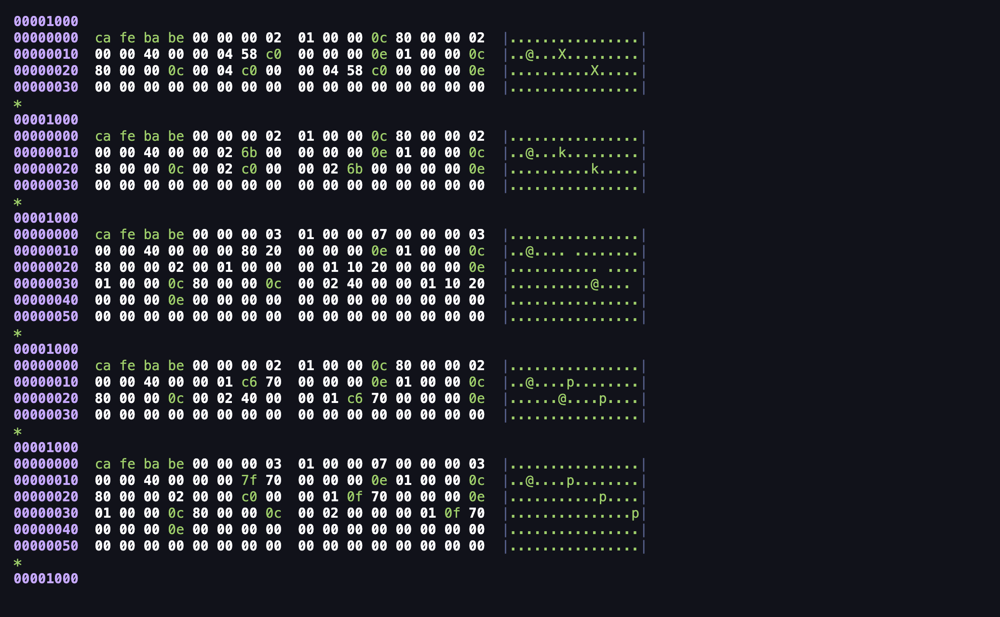
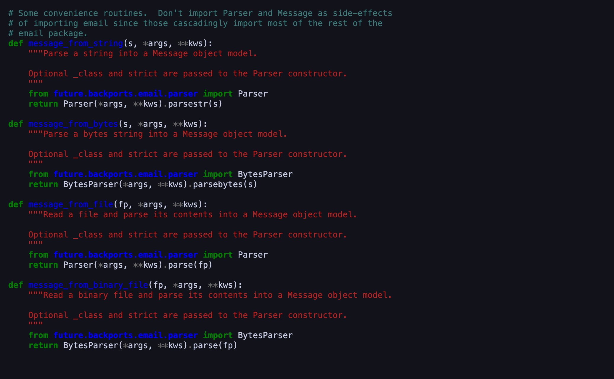
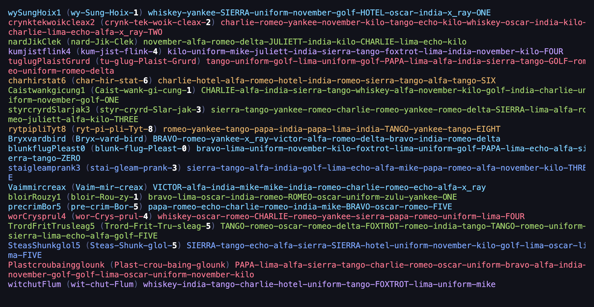
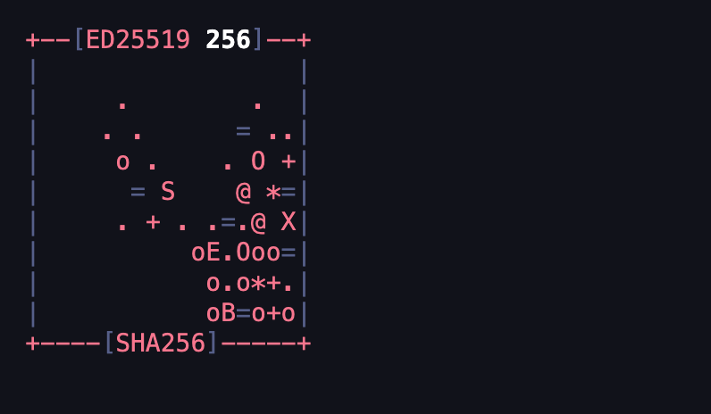

<div align="center">

</div>

# hollywood

<div align="center">

**Fill your terminal with Hollywood melodrama technobabble — now on macOS.**

<!-- headline - generated by tools/badges.py, refreshed by CI on every push to main -->
[](CHANGELOG.md)
[](bin/hollywood)
[](tests/)

[](https://www.paypal.com/donate/?business=martin.pfeffer%40celox.io&item_name=hollywood&currency_code=EUR)

<!-- status -->
[](https://github.com/pepperonas/hollywood/actions/workflows/tests.yml)
[](https://github.com/pepperonas/hollywood/actions/workflows/tests.yml)
[](LICENSE)
[](https://semver.org/spec/v2.0.0.html)
[](CHANGELOG.md)
[](https://github.com/pepperonas/hollywood/releases/latest)
[](https://github.com/pepperonas/hollywood/commits/main)

<!-- runtime -->
[](lib/hollywood)
[](#the-widgets)
[](#usage)
[](#usage)
[](#how-it-works)
[](#usage)
[](#how-it-works)
[](#installation)

<!-- platforms -->
[](#platform-support)
[](#platform-support)
[](#installation)

<!-- repository -->
[](https://github.com/pepperonas/hollywood)
[](https://github.com/pepperonas/hollywood)
[](https://github.com/pepperonas/hollywood/commits/main)
[](https://github.com/pepperonas/hollywood/issues)
[](https://github.com/pepperonas/hollywood/pulls)

<!-- social -->
[](https://github.com/pepperonas/hollywood/stargazers)
[](https://github.com/pepperonas/hollywood/network/members)

**[hollywood.celox.io](https://hollywood.celox.io)** · [Download](https://hollywood.celox.io/download) · [Changelog](CHANGELOG.md)

</div>

hollywood splits your terminal into panes and fills each one with something that looks
busy: a world map, falling code, hex dumps, scrolling source, key fingerprints, network
traffic. It is the screen in the background of every film in which someone says "I'm in".
Every few seconds the panes are torn down and dealt again.

This is the **macOS port** of [Dustin Kirkland's hollywood](https://github.com/dustinkirkland/hollywood).
The original is written for Ubuntu and reads `/sys`, `/proc` and tools that Homebrew does
not ship; this version runs on a Mac out of the box and behaves on Linux as before.



## Contents

- [Installation](#installation)
- [Usage](#usage)
- [The widgets](#the-widgets)
- [What the macOS port changes](#what-the-macos-port-changes)
- [Platform support](#platform-support)
- [How it works](#how-it-works)
- [What the panes show](#what-the-panes-show)
- [Development](#development)
- [Troubleshooting](#troubleshooting)
- [Support this project](#support-this-project)
- [Changelog](#changelog)
- [License](#license)
- [Author](#author)

## Installation

**Homebrew** (macOS, also Linuxbrew) — installs hollywood and every program its widgets use:

```sh
brew install pepperonas/tap/hollywood
```

**Installer script** — downloads the newest release, verifies its SHA-256 and installs into
`~/.local` (no root; `PREFIX=/usr/local` for a system-wide copy). It tells you which of the
widget programs are missing:

```sh
curl -fsSL https://github.com/pepperonas/hollywood/releases/latest/download/install.sh | sh
```

**From a checkout** — nothing to build:

```sh
git clone https://github.com/pepperonas/hollywood.git
brew install tmux bat bmon cmatrix figlet htop jp2a moreutils mplayer pv pygments tree
hollywood/bin/hollywood
```

Only `tmux` is required. A widget whose program is missing simply does not show up.

## Usage

```sh
hollywood                 # as many panes as fit this machine
hollywood -s 8            # eight panes
hollywood -s 6 -d 20      # six panes, dealt again every 20 seconds
hollywood --version
```

| Option | Meaning | Default |
|---|---|---|
| `-s`, `--splits N` | number of panes | twice the CPU count, at most the number of widgets |
| `-d`, `--delay S` | seconds until the panes are dealt again | 10 |
| `-V`, `--version` | print the version | |
| `-h`, `--help` | open the man page | |

While the show runs, a toolbar at the bottom holds every control as a button, and says
what the show is doing: the seconds until the next deal, *paused* or *zoomed*. Everything
works with the mouse and with a key:

| Mouse | Key | What it does |
|---|---|---|
| click on a pane | | select it; its name on the border lights up |
| double click on a pane | `z` | zoom: show that pane alone, and all of them again |
| right click on a pane | | menu for that pane: close, zoom, open, deal, pause, bring back, quit |
| drag a border | | resize the panes |
| `x close` | `x` | close the selected pane — its widget stays away for the rest of the show |
| `a open` | `a` | pick one of the twenty widgets and start it in a new pane now |
| `r back (n)` | `r` | bring back what was closed |
| `n deal` | `n` | deal the panes again now |
| `p pause` | `p`, space | pause the automatic dealing, and resume it |
| `-` `+` | `-` `+` | one pane fewer or more |
| `?` | `?` | the keys, in a window of their own |
| `q quit` | `q`, `Ctrl-C` | quit |

The last pane cannot be closed; `q` ends the show. While a pane is zoomed or the show is
paused, the clock stands still. What you closed is forgotten when the show ends.

Started from a plain terminal, hollywood creates a tmux session named `hollywood` and
closes it again. The controls exist only there: they live in a key table of their own and
need tmux's mouse support, and hollywood sets neither in a session it did not create.
Started inside an existing tmux session, it opens one window, leaves the rest alone, and
is steered with tmux's own keys (`Ctrl-b x` closes a pane). The clickable toolbar needs
tmux 3.4 or newer.

A machine with many cores gets many panes — on a ten-core Mac that is all twenty widgets
at once, which wants a large window. `-s 8` is a good number for a laptop screen.

## The widgets

| Widget | What you see | Program |
|---|---|---|
| `apg` | pronounceable passwords, spelled out | apg¹ |
| `atop` | process monitor | atop¹ |
| `bat` | source files with syntax highlighting | [bat](https://github.com/sharkdp/bat) |
| `bmon` | bandwidth monitor | bmon |
| `cmatrix` | the falling characters | cmatrix |
| `code` | source files scrolling by | pygmentize |
| `errno` | system error codes | errno (moreutils) |
| `figlet` | words like `ACCESS GRANTED` in block letters | figlet |
| `hexdump` | hex dumps of system binaries | hexdump |
| `htop` | process monitor | htop |
| `jp2a` | system pictures as ASCII art | jp2a |
| `logs` | system logs, coloured | ccze¹ |
| `man` | manual pages, coloured | man, ccze¹ |
| `map` | a world map as ASCII art | jp2a |
| `mplayer` | a sound wave, played as ASCII video | mplayer (libcaca) |
| `pv` | a transfer with progress bar | pv |
| `speedometer` | network throughput | speedometer¹ |
| `sshart` | SSH key fingerprints as random art | ssh-keygen |
| `stat` | file metadata | stat |
| `tree` | directory trees | tree |

¹ Not in Homebrew. On macOS a small stand-in from `share/hollywood/shims/` takes its
place — see below.

| | | |
|---|---|---|
|  |  |  |
|  |  |  |

## What the macOS port changes

- **One compatibility file.** Every widget sources `share/hollywood/compat.sh`. On macOS
  it swaps what only Linux has — `/sys`, `/proc/net/route`, `find -readable`, the output
  format of `stat` — for what the Mac offers. On Linux the widgets get the same paths and
  options as upstream.
- **Stand-ins for missing programs.** `ccze`, `apg` and `speedometer` are not in Homebrew
  and `atop` is Linux-only. `share/hollywood/shims/` holds small replacements: a
  log-colouring filter, a password generator with phonetic spelling, a throughput meter
  that reads the interface counters, and a hand-over to `top`. They are *appended* to
  `PATH`, so a real installation always wins. Their output looks similar to the originals,
  not identical.
- **The show can be steered.** Upstream is watch-only. Here every pane is named, and a
  toolbar, a context menu and a dozen keys close, open, zoom, deal and pause while it runs
  — see [Usage](#usage).
- **Ctrl-C ends the show cleanly.** Upstream ran `pkill -9 -f lib/hollywood/`, which also
  killed any other process with that path on its command line — an editor with a widget
  open, for one. Here a widget closes the tmux window it lives in, and nothing else.
- **The launcher follows its window, not the session name.** Once the widget window was
  gone, upstream addressed the session by name, reached the shell it had been started from
  and filled that with widgets again.
- **`wallstreet` moved out.** The sister program is its own project now:
  [pepperonas/wallstreet](https://github.com/pepperonas/wallstreet).

## Platform support

| Platform | Status |
|---|---|
| macOS (Apple silicon) | developed and run here — macOS 27, tmux 3.8 |
| macOS (Intel) | expected to work, not run |
| Linux | the widgets take upstream's code paths; covered by the unit tests in CI, not by a full run |

For Debian and Ubuntu the original package (`apt install hollywood`) remains the natural
choice.

## How it works

`bin/hollywood` starts a tmux session, opens a window with one widget and keeps splitting
it — alternating horizontally and vertically, at a random pane — until the requested number
of panes is reached. Every pane runs one script from `lib/hollywood/` at the lowest
scheduling priority (`nice -n 19`). After the delay, all panes but one are closed and the
deal starts again with a new shuffle.

Nothing is installed in the background, nothing is configured, and nothing leaves the
machine: no network requests, no telemetry.

## What the panes show

Some widgets show real things from the machine they run on: running processes (`htop`,
`atop`), log files (`logs`), file names (`tree`, `stat`), source files (`bat`, `code`) and
network throughput. That is the point — but look at the panes before you share your screen.
The pictures in this README were taken with `tools/screenshots.sh`, which leaves those
widgets out.

## Development

```sh
python3 -m unittest discover -s tests -v    # the suite, no tmux needed
tools/screenshots.sh                        # docs/screenshots/*.png
python3 tools/website_art.py                # banner, hero and mark
python3 tools/badges.py                     # the three counted README badges
```

The tests cover the launcher's options, the controls (against a stand-in for tmux that
records what it is asked), every widget (syntax, the compatibility layer,
no Linux-only paths, no kill-by-pattern), the compatibility layer under a faked `uname`
for both platforms, and the behaviour of each stand-in. `tools/termshot.py` turns a tmux
window into a PNG: it reads every pane's text with its colours, lays the panes out as tmux
has them and lets a Chromium-family browser take the picture.

A release is a tag: `git tag v1.2.3 && git push --tags`. The workflow checks that the tag
matches `VERSION`, runs the tests, builds `hollywood.tar.gz`, `install.sh` and
`SHA256SUMS`, and publishes them with the changelog section as notes. The project page
picks the release up by itself.

## Troubleshooting

- **A pane is missing or empty.** Its program is not installed; `install.sh` and
  `brew info pepperonas/tap/hollywood` list them.
- **Too many tiny panes.** Press `-` while it runs, pass `-s` with a smaller number, or enlarge the window.
- **The keys do nothing.** hollywood was started inside a tmux session of your own; the controls exist only in the session it creates itself.
- **The `speedometer` pane shows bars, not a graph.** That is the macOS stand-in. Install
  the real `speedometer` anywhere in your `PATH` and it takes over.

## Support this project

hollywood is free, Apache-licensed, ad-free and telemetry-free, and it will stay that way. If it
made a demo, a film set or a slow afternoon better, a coffee is always welcome:

<div align="center">

[](https://www.paypal.com/donate/?business=martin.pfeffer%40celox.io&item_name=hollywood&currency_code=EUR)

</div>

Not in a position to donate? A star, a bug report, or a note about how it behaves on a
machine I do not own is worth just as much.

## Changelog

See [CHANGELOG.md](CHANGELOG.md). The project follows
[Semantic Versioning](https://semver.org/spec/v2.0.0.html).

## License

[Apache-2.0](LICENSE). hollywood was written by Dustin Kirkland (2014–2026); this port keeps his licence and his copyright notices. What was changed is listed in [NOTICE](NOTICE).

## Author

**Martin Pfeffer**

- Website: [celox.io](https://celox.io)
- GitHub: [@pepperonas](https://github.com/pepperonas)

Original work: **Dustin Kirkland** — [hollywood.computer](https://hollywood.computer)
